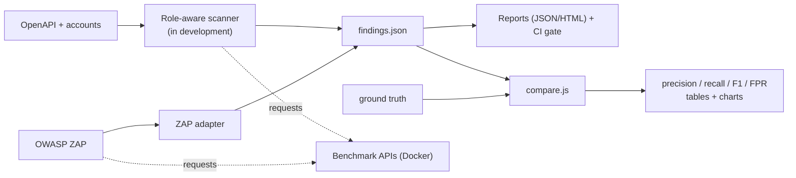

# Automated Detection of Broken Access Control Vulnerabilities in REST APIs

**A Role-Aware Testing Tool in JavaScript**: Bachelor's thesis artifact (Design Science Research)

> ⚠️ This repository contains **intentionally vulnerable** APIs. Run them only locally or in an
> isolated Docker environment (ports bind to `127.0.0.1`). All credentials are synthetic and benchmark-only.

## Project status

| Component | Status | Evidence |
|---|---|---|
| Thesis proposal and `Thesis Template/` | Preserved, unchanged | — |
| Benchmark API (`test-api/`), vulnerable + patched build | Implemented | 20 integration tests |
| OpenAPI 3.0 spec with intended policy (`x-access-control`) | Implemented | spec ↔ implementation consistency tests |
| Ground truth: test-api (234 scored cases) and VAmPI (35) | Implemented | drift and consistency tests |
| Findings format, redacted JSON/HTML reports, CI gate CLI | Implemented | unit tests (exit codes, redaction, escaping) |
| Evaluation: metrics, comparison tables, charts, regression check | Implemented | unit tests |
| Docker Compose (benchmark, patched build, VAmPI) | Implemented | built and health-checked locally |
| GitHub Actions workflow | Implemented | validated locally; not yet run on GitHub |
| OWASP ZAP comparison on test-api and VAmPI | **Executed** | `evaluation/results/2026-11-20-zap-test-api/`, `…-zap-vampi/` |
| Scanner foundation: OpenAPI parser, config validation, host allowlist, policy matrix, multi-account login, `preflight` command | Implemented | unit + integration tests; preflight run on test-api and VAmPI |
| **Role-aware detection engine** (test generation + scanner oracle + status-only oracle) | **Not implemented** | design in `docs/ARCHITECTURE.md`; plug-in contract in `docs/FINDINGS-FORMAT.md` |
| crAPI | Setup documented, not executed | `benchmarks/crapi/README.md` |

Only executed experiments have results. See `evaluation/README.md` for the list of planned and executed experiments.

## Research questions

1. **RQ1:** How can a role-aware testing tool use an OpenAPI specification and several user accounts to detect BOLA and BFLA vulnerabilities automatically?
2. **RQ2:** How do its precision, recall and false-positive rate compare with OWASP ZAP and with a simpler approach that checks only HTTP status codes?
3. **RQ3:** How much time and how many requests does the tool need, and can it run as part of a CI pipeline?

**Method:** Design Science Research. The tool is the artifact. It is evaluated in controlled experiments on a
benchmark with a known ground truth, and on intentionally vulnerable public applications (VAmPI, crAPI).

## Architecture



Details: [`docs/ARCHITECTURE.md`](docs/ARCHITECTURE.md) · decisions: [`docs/DECISIONS.md`](docs/DECISIONS.md) ·
findings contract: [`docs/FINDINGS-FORMAT.md`](docs/FINDINGS-FORMAT.md) · evaluation: [`evaluation/README.md`](evaluation/README.md) ·
thesis mapping: [`docs/THESIS-GUIDE.md`](docs/THESIS-GUIDE.md) · starter bibliography (verified DOIs): [`docs/references.bib`](docs/references.bib)

## Repository structure

```
├── Thesis-Topic-Proposal - V2.docx, Thesis Template/   # unchanged thesis materials
├── test-api/                 # benchmark API (Express), openapi.yaml, ground-truth*.json, Dockerfile, seeds/
├── cli-tool/config/          # example.config.yaml (benchmark accounts and roles)
├── cli-tool/src/
│   ├── cli.js                # `report` / `validate` / `preflight` commands with CI exit codes
│   ├── parser/ config/ authentication/ utils/   # OpenAPI parser, config + policy, login sessions, HTTP client
│   └── reporting/            # findings format, redaction, JSON + standalone HTML reports
├── evaluation/               # metrics, compare, charts, regression check, ground-truth builder, adapters/, results/
├── benchmarks/               # zap/ (runner), vampi/ (spec, ground truth), crapi/ (setup notes)
├── docs/                     # architecture, decisions, findings format, thesis guide
├── tests/                    # unit/, integration/, fixtures/ (node:test)
├── reports/                  # generated reports (git-ignored)
├── docker-compose.yml
└── .github/workflows/security-scan.yml
```

## Technology

Node.js 22 (ES modules, `node:test`), Express 5, jsonwebtoken, yaml, Docker / Docker Compose,
OWASP ZAP 2.17 (Docker), GitHub Actions. There are no other runtime dependencies.

## Quick start

```bash
npm install
```

```bash
npm test
```

```bash
docker compose up -d --build --wait
```

The vulnerable benchmark is then at `http://localhost:3000` and the patched build at `http://localhost:3001`.
Without Docker, use `npm run start:api` (add `FLAWS=none` for the patched build).

```bash
npm run seed:print
```

### Test accounts (synthetic)

| id | username | password | role |
|---|---|---|---|
| 1 | admin | Admin#2026 | admin |
| 2 | alice | Alice#2026 | user |
| 3 | bob | Bob#2026 | user |
| 4 | guest | Guest#2026 | guest (authenticated, read-only) |
| 5, 6 | carol, dave | Carol#2026, Dave#2026 | user (data owners not used as scanner accounts) |

`POST /__benchmark/reset` restores the seed (benchmark mode only; not part of the spec).

### Preflight (configuration check)

```bash
node cli-tool/src/cli.js preflight --spec test-api/openapi.yaml --config cli-tool/config/example.config.yaml
```

The command validates the spec and the config, refuses hosts outside `allowedHosts`, and logs in every account
(sending only the login requests). It then prints the operation inventory, the account identities and the intended
role/ownership policy per operation. Exit codes: `0` ready, `2` invalid input, `3` target unreachable or login failed.
The VAmPI configuration is `benchmarks/vampi/vampi.config.yaml`.

### Reports and CI gate

```bash
node cli-tool/src/cli.js report --input tests/fixtures/sample-findings.json --out-dir reports --fail-on high
```

The command writes a redacted `reports/json/*.json` and a self-contained `reports/html/*.html`.
Exit codes: `0` OK, `1` confirmed finding at or above `--fail-on`, `2` usage or input error.
(`sample-findings.json` is a synthetic fixture, not a scan result.)

### OWASP ZAP comparison

```bash
benchmarks/zap/run-zap.sh http://localhost:3000 evaluation/results/tmp/zap
```

```bash
node evaluation/compare.js --ground-truth test-api/ground-truth.json --run "OWASP ZAP=evaluation/results/tmp/zap/zap-findings.json" --out evaluation/results/tmp/zap/metrics
```

## Benchmark design

* **Resources:** user profiles, orders, invoices (nested ownership), documents (private/public), IoT
  devices and sensor readings, products, and admin functions. The spec has 47 operations.
* **20 injected flaws:** 8 BOLA, 6 BFLA, 2 missing authentication, 1 malformed token accepted,
  1 unverified JWT signature, 1 `alg: none` accepted, 1 expired token accepted (`test-api/src/flaws.js`).
* **True negatives with 2xx status:**
  - public documents,
  - an endpoint that ignores the path ID,
  - two soft denials (`200 {success:false}`),
  - a `202 Accepted` that is not applied for non-owners,
  - a role-filtered admin view.

  These are designed to separate a status-code oracle from an ownership-aware one.
* **Patched build** (`FLAWS=none`): the same code with every flaw fixed, used as a second true-negative dataset.

## Evaluation metrics

Precision = TP/(TP+FP), Recall = TP/(TP+FN), F1 = 2PR/(P+R), FPR = FP/(FP+TN). A case is
(method, path template, category). Metrics are reported per category and for the BOLA+BFLA and auth/JWT
groups, at a *confirmed* and a *confirmed+potential* threshold. Zero denominators are reported as undefined (`n/a`).

### Executed results so far (E1, E2)

With its standard API scan and one authenticated user, OWASP ZAP 2.17.0 detected **0 of 20** known
access-control vulnerabilities on the benchmark, with 0 false positives. Recall is 0.000, FPR is 0.000, and
precision is undefined. On VAmPI (E2), ZAP likewise reported no access-control finding: 0 of 3 detected in
vulnerable mode, 0 false positives. Details, raw output and validity notes are in `evaluation/results/`.

## CI/CD

`.github/workflows/security-scan.yml` has three jobs:

1. **test** runs the unit and integration tests.
2. **benchmark-scan** builds and starts both builds and waits for the health checks. It then runs `npm run scan:ci`
   (once the scanner provides it), gates the patched build with `--fail-on high`, regression-checks the
   vulnerable build against the ground truth, uploads the reports and cleans up Docker.
3. **zap-comparison** is an on-demand ZAP run.

Until `scan:ci` exists, the scan steps are skipped with a visible notice.

## Ethics and scope

Testing happens only against the local benchmark and intentionally vulnerable training applications in Docker.
No third-party systems are tested and no personal data is used.

## Limitations

* The detection engine (scanner and status-only baseline) is not yet implemented, so RQ1, the scanner side of
  RQ2, and RQ3 have no results yet.
* The benchmark and the tool are designed by the same author. The mitigations are the external benchmarks,
  the patched build and a ground truth fixed before any tool run.
* The benchmark spec carries policy annotations that real APIs usually lack. An ablation is planned.
* ZAP was evaluated in its standard single-user API scan. Its manual Access Control Testing add-on was not used.
* crAPI is documented but not yet evaluated.
