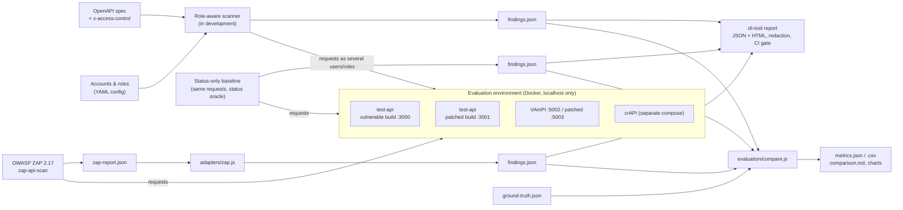

# Architecture

The repository is organised around the Design Science Research (DSR) cycle. There is an **artifact**
(the role-aware testing tool), an **evaluation environment** with a known ground truth, and an
**evaluation pipeline** that turns tool output into the metrics required by RQ2 and RQ3.

## Components

| Component | Location | Responsibility | Status |
|---|---|---|---|
| Benchmark API | `test-api/` | Express API with known BOLA, BFLA and auth flaws next to protected equivalents; flaw toggle `FLAWS`; deterministic seed; reset endpoint | Implemented, tested |
| OpenAPI spec | `test-api/openapi.yaml` | 47 operations with the *intended* policy in `x-access-control` | Implemented, tested for consistency |
| Ground truth | `test-api/ground-truth*.json`, `evaluation/build-ground-truth.js` | Labelled cases (method, path, category) | Implemented, tested |
| Findings format | `cli-tool/src/reporting/findings-format.js`, `docs/FINDINGS-FORMAT.md` | Contract between detectors and the pipeline | Implemented, tested |
| Reporting | `cli-tool/src/reporting/` | Validation, redaction, JSON + standalone HTML, severity gate | Implemented, tested |
| CLI | `cli-tool/src/cli.js` | `report`, `validate`, `preflight`; exit codes 0/1/2/3 | Implemented, tested |
| Scanner foundation | `cli-tool/src/{parser,config,authentication,utils}`, `preflight.js` | OpenAPI 3 parser ($ref, parameters, bodies, security, `x-access-control`); config loading and validation; host allowlist; policy resolution (config rules override the spec); sample request bodies; rate-limited HTTP client with request budget and counter; multi-account login with identity extraction | Implemented, tested (incl. against VAmPI) |
| Detection engine | `cli-tool/src/{engine,analyzers,detectors}` | Cross-user/cross-role test generation, authentication checks, ownership-differential and status-only oracles | **Not implemented** |
| Evaluation | `evaluation/` | Metrics, comparison, charts, regression check, ZAP adapter | Implemented, tested |
| ZAP integration | `benchmarks/zap/run-zap.sh` | Reproducible ZAP API scan with bearer authentication | Implemented, executed |
| External benchmarks | `benchmarks/vampi`, `benchmarks/crapi` | Setup, accounts, ground truth / configuration notes | VAmPI ground truth done; crAPI documented only |
| CI | `.github/workflows/security-scan.yml` | Tests, benchmark start-up, scan hook, gate, artifacts, cleanup | Implemented; not yet run on GitHub |

## Intended design of the detection engine

This section records the design the thesis proposes, so that the implementation and the
evaluation stay aligned. It is a specification, not a description of existing code.

1. **Inputs.** An OpenAPI document and a configuration with several accounts, their roles, and
   (for APIs without `x-access-control`) access rules and ownership-field names.
2. **Test generation is separate from the decision.** Test generation produces the same set of
   cross-user and cross-role requests for every detection strategy. A pluggable *oracle* then
   classifies each test. This lets RQ2 attribute differences to the oracle alone.
   - *Status-only oracle:* a 2xx response to a request the policy forbids counts as a vulnerability.
   - *Ownership-differential oracle:* a test is classified from the response body, the ownership
     identifiers, a comparison with the legitimate owner's response, and state verification
     after write and delete operations. The result is confirmed, potential, inconclusive or denied.
3. **Output.** A findings document in the format above, including `meta.requests` and
   `meta.durationMs` for RQ3.
4. **Safety.** Local targets only by default, request time-outs and throttling, and destructive
   methods only against objects the tool created itself.

The benchmark's true-negative patterns exist precisely to separate the two oracles. They are
documented in `test-api/ground-truth.json` (`notes`) and tested in
`tests/integration/test-api.secure-build.test.js`.
